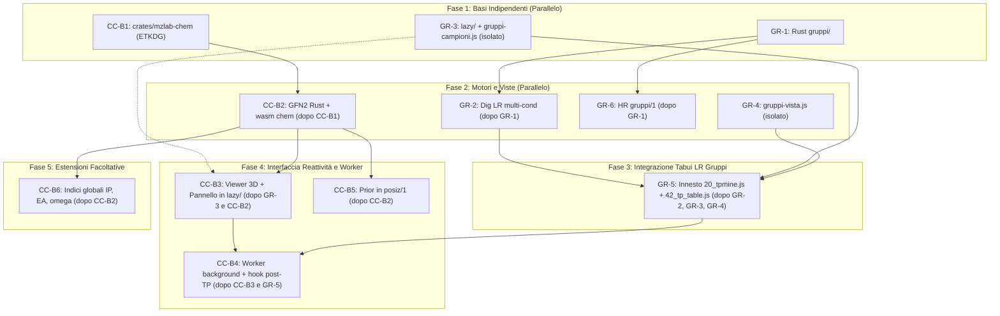

# Revisione di Coerenza dei Prompt DEV: Gruppi di Esperimenti e Chimica Computazionale nel Browser

Documento di audit e revisione sistematica per i prompt delle chat DEV dei pacchetti **GR-1..GR-6** (`docs/studi/PROMPT_GRUPPI/`) e **CC-B1..CC-B6** (`docs/studi/PROMPT_CC_BROWSER/`), basati sugli studi `docs/studi/TABUI_GRUPPI_ESPERIMENTI.md` e `docs/studi/CC_MOTORE_NEL_BROWSER.md`.

---

## 1. Sintesi Esecutiva della Revisione

La revisione ha esaminato la coerenza architetturale, contrattuale, temporale e regolamentare di **12 prompt DEV**, dei rispettivi documenti di coordinamento (`LEGGIMI.md`) e dei due studi progettuali di riferimento.

### Riepilogo Anomalie per Gravità

| Gravità | Conteggio | Descrizione sintetica |
|---|:---:|---|
| **Critica** | **1** | Violazione del tetto di avvio (1.55 MB) e assenza di lazy-loading nei prompt CC-B (file posizionati in `TP_Mine/js/` caricati all'avvio). |
| **Alta** | **3** | Condizione di corsa / conflitto di proprietà su `20_tpmine.js` (GR-3 vs GR-5); campo `other_polarity` mancante in `RowMeta` di GR-1; dipendenza mancante in `crates/mzlab-desktop/Cargo.toml` per `mzlab-chem`. |
| **Media** | **7** | Incoerenza nome campo `id` vs `row` in `gruppi/1`; comportamento non definito per `shape` con 2 tempi trattati; assenza di `[M+H]+ formula` nel JSON `gruppi/1` a fronte dell'export CSV HR; mancata specifica di rilevamento `hbonds`; ambiguità nullabilità indici globali e blocco `scc` in EHT per `reatt/1`; mancato bump di `BRIDGE` in `mzlab-feat-grafo-wasm`; esecuzione parallela di GR-4 priva dell'infrastruttura `TPLAZY`. |
| **Bassa** | **4** | Testi di note/controlli in italiano nei prompt CC-B; ambiguità dell'impatto di `in_parent_std` sul verdetto `prev.verdict`; criterio prestazionale non misurabile in CC-B4; potenziale divisione per zero in `ratio_ref` con area di riferimento nulla. |
| **Totale** | **15** | **Problemi censiti e indirizzati con correzione operativa.** |

---

## 2. Tabella Principale delle Incoerenze e Anomalie

| Prompt | Riga/Sezione | Problema riscontrato | Correzione proposta | Gravità |
|---|---|---|---|:---:|
| **CC-B3**, **CC-B4** | `CC-B3.md:12,19`, `CC-B4.md:13` | **Violazione del budget di avvio (1.55 MB)**: CC-B3 colloca `46_reattivita.js` e `47_viewer3d.js` in `TP_Mine/js/` anziché in `TP_Mine/lazy/`. Poiché `tools/build_site.py` (`pack_mzfinder`) include tutti i file di `TP_Mine/js/` in `indice.json`, essi vengono caricati all'avvio di Tabui anche se il pannello reattività non è aperto. | Spostare i file in `TP_Mine/lazy/reattivita.js` e `TP_Mine/lazy/viewer3d.js`. Introdurre il caricamento tramite `TPLAZY.load()` alla prima apertura del riquadro «Parent compound» (solo con `uipAdminOn()`). | **Critica** |
| **GR-3**, **GR-5** | `GR-3.md:15`, `GR-5.md:3,13` | **Conflitto di sequenziamento e corsa su `20_tpmine.js`**: Le PR #871 e #873 risultano già unite in `main`. GR-3 tenta l'innesto in `20_tpmine.js` al Passo 1 (parallelo a GR-1), passando al Dig opzioni `campioni` e `reference` che il Dig LR non supporta fino a GR-2 (Passo 2). Ciò vìola il vincolo di `TABUI_GRUPPI_ESPERIMENTI.md` §7 («GR-1..GR-4 non toccano quei file; GR-5 parte dopo il merge»). | Rimuovere l'innesto su `20_tpmine.js` da GR-3. GR-3 deve produrre esclusivamente `TP_Mine/lazy/gruppi-campioni.js`, il caricatore pigro e il test isolato. Riservare l'intero innesto su `20_tpmine.js` a GR-5 dopo il merge di GR-2, GR-3 e GR-4. | **Alta** |
| **GR-1**, **GR-2** | `GR-1.md:14`, `GR-2.md:17` | **Campo `other_polarity` mancante in `RowMeta`**: Lo studio §3 definisce `"other_polarity": null \| 12` nelle righe di `gruppi/1`. GR-1 definisce `RowMeta` privo di `other_polarity`. GR-2 calcola la polarità opposta al punto 5 ma non può passarla a `gruppi::build` se `RowMeta` non ha il campo. | Aggiungere `other_polarity: Option<usize>` nella struct `RowMeta` in `GR-1.md` (`crates/mzlab-feat/src/gruppi/mod.rs`), serializzandolo come `null` o indice numerico in `json.rs`. | **Alta** |
| **CC-B2** | `CC-B2.md:21` | **Mancata dipendenza in `crates/mzlab-desktop/Cargo.toml`**: CC-B2 implementa la rotta nativa `feat/grafo` (`kind: "reactivity"`) in `crates/mzlab-desktop/src/feat_grafo.rs` invocando `mzlab_chem::reactivity_json`. Tuttavia, `crates/mzlab-desktop` non dichiara la dipendenza dal nuovo crate `mzlab-chem` in `Cargo.toml`. | Inserire `crates/mzlab-desktop/Cargo.toml` tra i file toccati da CC-B2 (o CC-B1) aggiungendo `mzlab-chem = { path = "../mzlab-chem" }`. | **Alta** |
| **GR-1**, **GR-4** | `GR-1.md:14`, `GR-4.md:13` | **Incoerenza di nome campo `id` vs `row` in `gruppi/1`**: `RowMeta` in GR-1 definisce `id: usize`, mentre il contratto JSON §3 e le `sets` usano `"row": 7` e `"rows": [7, 9]`. Una serializzazione diretta senza `#[serde(rename = "row")]` genera `"id": 7`, rompendo la lettura in JS (`TPGRUPPI_VIEW`). | Specificare in GR-1 che la struct serializzata per ciascuna riga del JSON deve esporre la chiave `"row"` (oppure rinominare il campo in `RowMeta` come `row: usize`). | **Media** |
| **GR-1** | `GR-1.md:16,27`, Studio §3:64 | **Comportamento non definito per 2 tempi trattati in `shape`**: Lo studio specifica `single` per 1 tempo e `rising`/`bell`/`decay`/`flat` per ≥ 3 tempi trattati. Non è specificato cosa debba essere restituito con esattamente 2 tempi trattati. | Chiarire in GR-1: con 2 tempi trattati `bell` è escluso (richiede massimo interno); la classificazione deve valutare `rising` (t2 > 1.5 * t1), `decay` (t1 > 1.5 * t2) o `flat`, oppure restituire `null`. | **Media** |
| **GR-1**, **GR-4**, **GR-6** | `GR-1.md:14`, `GR-4.md:19`, Studio §6:103 | **Assenza di `[M+H]+ formula` in `gruppi/1`**: Lo studio §6:103 prescrive per l'export CSV HR le colonne «Neutral formula», «[M+H]+ formula», «Δ ppm». Tuttavia `RowMeta` e `gruppi/1` contengono solo `neutral_formula` e `ppm`. JS non può calcolare la formula dello ione senza violare la regola dei calcoli in Rust. | Aggiungere `ion_formula: Option<String>` a `RowMeta` in GR-1 e nell'uscita `gruppi/1` popolato da GR-6 per HR, oppure limitare l'export CSV in GR-4 a «Neutral formula» e «Δ ppm». | **Media** |
| **CC-B1**, **CC-B2** | `CC-B1.md:13`, `CC-B2.md`, Studio §8:127 | **Rilevamento legami idrogeno (`hbonds`) non assegnato**: Il contratto `reatt/1` richiede `"hbonds": [ { "donor_h", "acceptor" } ]` e CC-B3 li disegna tratteggiati nel viewer 3D. Né CC-B1 (geometria) né CC-B2 (GFN2) specificano la funzione per il calcolo geometrico degli hbonds. | Assegnare esplicitamente a CC-B1 (in `mol3d.rs` o `geom/`) il calcolo dei legami a idrogeno intramolecolari in base a distanza donor(H)...acceptor ≤ 2.5 Å e angolo > 120°. | **Media** |
| **CC-B2**, **CC-B3**, **CC-B6** | `CC-B2.md:18,20`, `CC-B6.md:1`, Studio §8:127 | **Nullabilità indici globali e blocco `scc` sotto fallback EHT**: CC-B6 è facoltativo, quindi `ip_ev`, `ea_ev`, `mu_ev`, `eta_ev`, `omega_ev` in `global` possono mancare. Inoltre, con il ripiego EHT (non iterativo), `scc` non ha cicli SCF. | Dichiarare `global.*_ev` come opzionali (`null` se assenti). Specificare che con `method: "EHT"`, `scc` restituisce `{ "converged": [true, false, false], "iterations": [1, 0, 0] }` o `null`, e CC-B3 deve verificare la presenza prima di visualizzarlo. | **Media** |
| **CC-B5** | `CC-B5.md:13,23` | **Mancato incremento versione bridge in `crates/mzlab-feat-grafo-wasm`**: L'estensione di `positions()` per ricevere i dati `prior` modifica l'ABI WASM. La costante `const BRIDGE: &str = "mzfeat-grafo/4"` non viene incrementata, causando disallineamento nei controlli di versione del caricatore. | Istruire CC-B5 ad aggiornare `BRIDGE` a `"mzfeat-grafo/5"` in `crates/mzlab-feat-grafo-wasm/src/lib.rs` e nel rispettivo test/documento d'area. | **Media** |
| **GR-3**, **GR-4** | `GR-3.md:13`, `GR-4.md:1` | **Mancanza di dipendenza dell'infrastruttura `TPLAZY` per GR-4**: GR-3 e GR-4 sono pianificati in parallelo al Passo 1. GR-4 definisce `TP_Mine/lazy/gruppi-vista.js` presupponendo `TPLAZY.load`, ma il meccanismo viene creato da GR-3 in `tpmine-loader.js`. | Chiarire che GR-4 durante lo sviluppo isolato al Passo 1 usa la pagina di prova `TP_Mine/tests/gruppi_vista.html` senza invocare `TPLAZY.load`, la cui integrazione avviene in GR-5. | **Media** |
| **CC-B3**, **CC-B4** | `CC-B3.md:15`, `CC-B4.md:16` | **Testi e note in italiano nelle specifiche dell'interfaccia**: CC-B3 riporta una nota in italiano («f(0) sbaglia sugli anelli disattivati») e CC-B4 descrive le opzioni in italiano («solvente acqua o nessuno»). Tabui deve essere rigorosamente in lingua inglese. | Sostituire con le stringhe inglesi: `"f(0) radical susceptibility may fail on deactivated rings with •OH; f(−) is recommended for electrophilic attack"` e `"Solvent: Water / None"`, `"Conformers: 8"`. | **Bassa** |
| **GR-1** | `GR-1.md:16`, Studio §3:65 | **Ambiguità sull'effetto di `in_parent_std` su `prev.verdict`**: Lo studio indica che la presenza nello standard del genitore è «solo un suggerimento, mai un'esclusione», ma indica anche che «Prev. unlikely se un controllo fallisce». Non è esplicitato se `in_parent_std == "yes"` sia considerato controllo fallito. | Chiarire in GR-1 che `in_parent_std == "yes"` costituisce un flag informativo e NON degrada il verdetto a `"Prev. unlikely"`. Solo `absent_t0 == "fail"` o `absent_blank == "fail"` portano a `"Prev. unlikely"`. | **Bassa** |
| **CC-B4** | `CC-B4.md:21` | **Criterio di fine non quantificato numericamente**: Il prompt indica «differenza entro il rumore» per il tempo dei TP con e senza calcolo di reattività in background, senza definire una soglia percentuale o assoluta. | Definire la soglia: «il tempo di calcolo dei TP con worker di reattività attivo in background non deve aumentare di oltre il 5% (o > 200 ms) rispetto al tempo senza calcolo». | **Bassa** |
| **GR-1**, **GR-2** | `GR-1.md:16`, Studio §3:62 | **Potenziale divisione per zero in `ratio_ref`**: `ratio_ref = area(cond) / area(rif)`. Se il riferimento è presente ma la sua area all'endpoint comune è 0.0 (es. degradato al 100%), il rapporto genera `+Inf` o `NaN`. | Specificare in GR-1: se `area(rif) <= 0.0`, `ratio_ref` deve essere serializzato come `null` con warning o nota nel payload. | **Bassa** |

---

## 3. Analisi di Coerenza dei Contratti

### 3.1 Contratto `gruppi/1` (Condizioni a Confronto)

```
Rust: GroupTable + Campione -> gruppi::build() -> GroupsOut (crates/mzlab-feat/src/gruppi/)
                                     ↓
WASM: finder_lr_wasm / feat_table_wasm (JSON gruppi/1)
                                     ↓
JS:   TPGRUPPI_FILES (lazy) -> TPGRUPPI_VIEW (lazy) -> 42_tp_table.js (Tabui LR/HR)
```

#### Mappa dei Campi e Tipi di Dato

| Campo JSON | Tipo JSON | Tipo Rust (`gruppi/`) | Presenza / Note |
|---|---|---|---|
| `format` | string (`"gruppi"`) | `&'static str` | Fisso `"gruppi"` |
| `version` | integer (`1`) | `u32` | Fisso `1` |
| `reference` | string \| null | `Option<String>` | Condizione di riferimento |
| `norm` | string (`"raw"`) | `NormMode` (`"raw"`) | Solo `"raw"` in GR-1 |
| `conditions[].id` | string | `String` | Etichetta condizione (`serie` di `campioni/2`) |
| `conditions[].factors` | object | `BTreeMap<String, String>` | Mappa libera facoltativa; `{}` se vuota |
| `conditions[].files` | array of int | `Vec<usize>` | Indici colonne del file full trattati |
| `conditions[].times` | array of num | `Vec<f64>` | Tempi trattati distinti (minuti) |
| `conditions[].replicates` | integer | `u32` | Max repliche riscontrate |
| `conditions[].controls` | object | `Controls` | `t0`, `blank`, `std`, `dark` (liste indici file) |
| `conditions[].parent` | object | `ParentKinetics` | `k`, `half_life`, `remaining` (da `kin::decay`) |
| `rows[].row` | integer | `usize` | **Incoerenza**: definito `id` in `RowMeta`, deve essere `row` |
| `rows[].tp_name` | string | `String` | Nome canonico TP da `nomi::tp_names` |
| `rows[].mz` | number | `f64` | m/z del precursore |
| `rows[].polarity` | string (`"+"` \| `"-"`) | `String` o `char` | Polarità dello ione |
| `rows[].rt` | number | `f32` | Tempo di ritenzione all'apice (min) |
| `rows[].neutral_formula`| string \| null | `Option<String>` | Formula neutra (solo HR, null in LR) |
| `rows[].ppm` | number \| null | `Option<f64>` | Errore massa in ppm (solo HR, null in LR) |
| `rows[].other_polarity` | integer \| null | `Option<usize>` | **Mancante in `RowMeta` di GR-1**; riga opposta se presente |
| `rows[].present_in` | array of string | `Vec<String>` | Lista condizioni in cui il TP è presente |
| `rows[].only_in` | string \| null | `Option<String>` | Condizione esclusiva, o `null` |
| `rows[].in_all` | boolean | `bool` | True se presente in tutte le condizioni |
| `rows[].cond[].id` | string | `String` | ID della condizione |
| `rows[].cond[].present`| boolean | `bool` | Presenza secondo repliche e soglia area |
| `rows[].cond[].n_det` | integer | `u32` | Repliche rilevate al tempo massimo |
| `rows[].cond[].n_rep` | integer | `u32` | Repliche totali al tempo massimo |
| `rows[].cond[].area` | number | `f64` | Area media (notazione scientifica in UI) |
| `rows[].cond[].area_sd`| number \| null | `Option<f64>` | Deviazione standard repliche |
| `rows[].cond[].cv` | number \| null | `Option<f64>` | Coefficiente di variazione (sd / media) |
| `rows[].cond[].ratio_ref`| number \| null | `Option<f64>` | Rapporto col rif. all'endpoint comune |
| `rows[].cond[].shape` | string \| null | `Option<Shape>` | `"single"`, `"rising"`, `"bell"`, `"decay"`, `"flat"` |
| `rows[].cond[].t_max` | number \| null | `Option<f64>` | Tempo del picco massimo dell'area |
| `rows[].cond[].t_half_rise`| number \| null | `Option<f64>` | Tempo al 50% della salita (interpolato) |
| `rows[].cond[].rate_rel`| number \| null | `Option<f64>` | Tasso relativo rispetto al riferimento |
| `rows[].cond[].kin[]` | array of object | `Vec<KinPoint>` | Punti cinetica: `t`, `area`, `sd`, `n` |
| `rows[].cond[].prev` | object | `PrevBlock` | `absent_t0`, `absent_blank`, `in_parent_std`, `above_min`, `ms2`, `verdict` |
| `sets[]` | array of object | `Vec<ConditionSet>` | Colonne UpSet: `conditions: Vec<String>`, `rows: Vec<usize>` |
| `warnings[]` | array of object | `Vec<GroupWarning>`| `code` (`refMissing`, `condNoControls`, `mixedTimes`, etc.), `condition` |

---

### 3.2 Contratto `reatt/1` (Reattività del Genitore nel Browser)

```
Rust: Mol3d (geom) -> solve (GFN2-xTB / EHT) -> reactivity_json() (crates/mzlab-chem/)
                                     ↓
WASM: mzlab-chem-wasm (version "mzlab-chem/1", export reactivity_json)
                                     ↓
JS:   chem-worker.js -> TPREATT (46_reattivita.js) + Viewer 3D (47_viewer3d.js)
```

#### Mappa dei Campi e Tipi di Dato

| Campo JSON | Tipo JSON | Tipo Rust (`mzlab-chem`) | Note e Vincoli |
|---|---|---|---|
| `format` | string (`"reatt"`) | `&'static str` | Fisso `"reatt"` |
| `version` | integer (`1`) | `u32` | Fisso `1` |
| `engine` | string | `String` | `"mzlab-chem/1"` |
| `method` | string | `String` | `"GFN2-xTB"` (principale) o `"EHT"` (ripiego) |
| `solvent` | string | `String` | `"water"` (ALPB) o `"none"` (gas) |
| `smiles` | string | `String` | SMILES canonico in ingresso |
| `atoms[].i` | integer | `usize` | Indice atomo in 3D (0-based, include H) |
| `atoms[].el` | string | `String` | Simbolo elemento (`"C"`, `"H"`, `"O"`, etc.) |
| `atoms[].heavy_index` | integer \| null | `Option<usize>` | Indice atomo pesante in `grafo::Mol` (null per H) |
| `atoms[].x, y, z` | number | `f64` | Coordinate cartesiane in Angstrom |
| `atoms[].q` | number | `f64` | Carica parziale di Mulliken |
| `atoms[].f_plus` | number | `f64` | Indice di Fukui nucleofilo $f(+)$ |
| `atoms[].f_zero` | number | `f64` | Indice di Fukui radicalico $f(0)$ |
| `atoms[].f_minus` | number | `f64` | Indice di Fukui elettrofilo $f(-)$ |
| `atoms[].dual` | number | `f64` | Descrittore duale $\Delta f = f(+) - f(-)$ |
| `bonds[].a, b` | integer | `usize` | Indici atomi legati |
| `bonds[].order` | integer | `u8` | Ordine legame (1, 2, 3, arom.) |
| `hbonds[].donor_h` | integer | `usize` | **Da assegnare a CC-B1/B2**: indice H donatore |
| `hbonds[].acceptor` | integer | `usize` | Indice atomo accettore O/N |
| `global.homo_ev` | number | `f64` | Energia HOMO in eV |
| `global.lumo_ev` | number | `f64` | Energia LUMO in eV |
| `global.gap_ev` | number | `f64` | Gap HOMO-LUMO in eV |
| `global.ip_ev` | number \| null | `Option<f64>` | Potenziale di ionizzazione verticale (CC-B6) |
| `global.ea_ev` | number \| null | `Option<f64>` | Affinità elettronica verticale (CC-B6) |
| `global.mu_ev` | number \| null | `Option<f64>` | Potenziale chimico elettronico $\mu$ (CC-B6) |
| `global.eta_ev` | number \| null | `Option<f64>` | Durezza chimica $\eta$ (CC-B6) |
| `global.omega_ev` | number \| null | `Option<f64>` | Elettrofilicità globale $\omega$ (CC-B6) |
| `conformers.n` | integer | `usize` | Conformeri generati (default 8) |
| `conformers.chosen` | integer | `usize` | Indice conformero a minima energia |
| `conformers.f_minus_spread` | number | `f64` | Dispersione max di $f(-)$ sui 3 conformeri più bassi |
| `scc.converged` | array of bool \| null | `Option<[bool; 3]>` | Convergenza N, N+1, N-1 (null o `[true, false, false]` in EHT) |
| `scc.iterations` | array of int \| null | `Option<[u32; 3]>` | Iterazioni Broyden per i 3 stati (null in EHT) |
| `notes` | array of string | `Vec<String>` | Limiti metodologici fissi (in inglese) |
| `cite` | array of string | `Vec<String>` | Riferimenti bibliografici e DOI |

---

### 3.3 Contratto `posiz/1` (Posizioni di Sostituzione) e Innesto `prior`

```
Rust: posizioni::match_spectrum() -> posizioni_json(..., prior_json) (crates/mzlab-feat/)
                                     ↓
WASM: mzfeat-grafo-wasm (nuova funzione o argomento opzionale; BRIDGE da bumpare a v5)
                                     ↓
JS:   TPPOS (44_posizioni.js) mostra colonna «Prev. f(−)» senza toccare proposal 3a/3b
```

- **Allineamento indici**: in `posiz/1`, `sites[].atom` è l'indice 0-based nell'ordine del grafo SMILES (`grafo::Mol`). Corrisponde esattamente a `heavy_index` di `reatt/1`. Nella UI di Tabui viene formattato come simbolo + indice 1-based (es. `C4`).
- **Campo `prior`**:
  ```json
  "prior": [
    {
      "atom": 3,
      "value": 0.081,
      "rank": 1,
      "quantity": "f_minus",
      "method": "GFN2-xTB",
      "note": "Prev."
    }
  ]
  ```
- **Invarianza decisionale**: `prior` è strettamente informativo. `proposal.sublevel` (3a/3b) e gli insiemi di classi `supported`, `excluded`, `undistinguished` non vengono alterati dal rango di reattività.

---

### 3.4 Contratto `campioni/2` (Modello dei File e Ruoli)

- Modello canonico definito in `docs/schemi/campioni-2.json` e `crates/mzlab-core/src/campioni/mod.rs`.
- La chiave JSON è `"serie"`, mappata nel campo Rust `pub series: String`.
- `serie == ""` indica campioni e controlli condivisi da tutte le condizioni; `serie != ""` assegna il file alla condizione specifica.
- **Distinzione avvisi**:
  - `campioni::valida` (pre-corsa nella tabella dei file): restituisce codici come `noControls`, `noT0`, `noBlank`, `onePoint`, `replicates`.
  - `gruppi.warnings` (post-corsa nel JSON `gruppi/1`): restituisce codici con prefisso condizione come `refMissing`, `condNoControls`, `condOnePoint`, `condNoReplicates`, `mixedTimes`.

---

## 4. Verifica Esistenza File Citati

Tutti i percorsi menzionati nei prompt e negli studi sono stati verificati tramite comandi bash sul file system locale del worktree.

### 4.1 File e Risorse Esistenti nel Repository (Tutti Verificati: SÌ)

| File / Cartella citata nei prompt | Esiste | Note |
|---|:---:|---|
| `AGENTS.md` | **SÌ** | File di contesto del repository |
| `Cargo.toml` | **SÌ** | Workspace Cargo alla radice |
| `crates/mzlab-core/src/campioni/mod.rs` | **SÌ** | Modulo tipi e parsing `campioni/2` |
| `crates/mzlab-core/src/campioni/valida.rs` | **SÌ** | Validazione ruoli e controlli per serie |
| `crates/mzlab-feat/src/lib.rs` | **SÌ** | Root crate feature e calcoli |
| `crates/mzlab-feat/src/legacy/lr/kin.rs` | **SÌ** | Funzioni `kinetics`, `decay` |
| `crates/mzlab-feat/src/legacy/lr/labels.rs` | **SÌ** | Costante `RATIO_MAX`, struct `Cell` |
| `crates/mzlab-feat/src/legacy/lr/nomi.rs` | **SÌ** | Funzione `tp_names` (PR #871 integrata) |
| `crates/mzlab-feat/src/legacy/lr/ms2assoc.rs` | **SÌ** | Abbinamento MS2 (PR #873 integrata) |
| `crates/mzlab-feat/src/legacy/lr/plan.rs` | **SÌ** | Struct `FileLr`, `Settings` |
| `crates/mzlab-feat/src/legacy/lr/rows.rs` | **SÌ** | Struct celle e allineamento LR |
| `crates/mzlab-feat/src/legacy/series.rs` | **SÌ** | Struct `FileIn` |
| `crates/mzlab-feat/src/kinetic/forms.rs` | **SÌ** | Classificazione forme cinetiche |
| `crates/mzlab-feat/src/tp/tabella.rs` | **SÌ** | Tabella prodotti HR |
| `crates/mzlab-feat/src/tp/rete.rs` | **SÌ** | Correlazione di rete tra prodotti |
| `crates/mzlab-feat/src/chem/grafo.rs` | **SÌ** | Grafo SMILES e molecola |
| `crates/mzlab-feat/src/chem/posizioni.rs` | **SÌ** | Posizioni di sostituzione |
| `crates/mzlab-feat/src/chem/posizioni/` | **SÌ** | Sottomodulo posizioni |
| `crates/mzlab-feat-table-wasm` | **SÌ** | Crate binding WASM tabella feature |
| `crates/mzlab-feat-grafo-wasm/src/lib.rs` | **SÌ** | Crate binding WASM grafo molecolare |
| `crates/mzlab-finder-lr-wasm/src/lib.rs` | **SÌ** | Crate binding WASM Dig LR |
| `crates/mzlab-desktop/src/feat_grafo.rs` | **SÌ** | Handler rotta desktop `feat/grafo` |
| `tools/build_site.py` | **SÌ** | Script di impacchettamento e copia sito |
| `tools/build_feat_wasm.sh` | **SÌ** | Script di compilazione dei moduli WASM |
| `tools/tipi/pagina.json` | **SÌ** | Configurazione typecheck `tsc` |
| `tools/dati_sintetici.py` | **SÌ** | Generatore mzML sintetici serie B |
| `tools/bench.py` | **SÌ** | Benchmark prestazioni |
| `mzlab/web/tpmine-loader.js` | **SÌ** | Caricatore script di mzFinder |
| `mzlab/web/tour.js` | **SÌ** | Tour guidato della pagina |
| `mzlab/web/settings.js` | **SÌ** | Impostazioni e `uipAdminOn()` |
| `TP_Mine/files/finder-ruoli.js` | **SÌ** | Proposta ruoli e tempi da Rust |
| `TP_Mine/files/finder-lr.js` | **SÌ** | Chiamata al worker Dig LR |
| `TP_Mine/files/feat-worker.js` | **SÌ** | Worker supervisore pipeline |
| `TP_Mine/js/20_tpmine.js` | **SÌ** | Script principale Tabui LR |
| `TP_Mine/js/21_tpmine_hr.js` | **SÌ** | Script principale Tabui HR |
| `TP_Mine/js/34_pipeline_run.js` | **SÌ** | Tabella ruoli pipeline |
| `TP_Mine/js/40_tabui_testi.js` | **SÌ** | Catalogo testi inglesi di Tabui |
| `TP_Mine/js/42_tp_table.js` | **SÌ** | Componente tabella TP |
| `TP_Mine/js/44_posizioni.js` | **SÌ** | Componente substitution positions |
| `tests/golden/finder_lr_contratto.json` | **SÌ** | Contratto d'oro del Dig LR |
| `tests/data/xtb/` | **SÌ** | Cartella per uscite di riferimento xtb |
| `tests_e2e/e2e_tpmine_lr_rust.py` | **SÌ** | Test e2e Dig LR Rust |
| `tests_e2e/e2e_tpmine_lr_tabella.py` | **SÌ** | Test e2e tabella TP LR |
| `tests_e2e/e2e_tpmine_rtalign.py` | **SÌ** | Test e2e allineamento RT |
| `tests_e2e/e2e_tpmine_ms2_lr.py` | **SÌ** | Test e2e abbinamenti MS2 |
| `tests_e2e/e2e_tabui_tptab.py` | **SÌ** | Test e2e vista prodotti TPTAB |
| `tests_e2e/e2e_tour.py` | **SÌ** | Test e2e tour guidato |
| `tests_e2e/e2e_posizioni.py` | **SÌ** | Test e2e posizioni di sostituzione |
| `crates/mzlab-feat/tests/tp_vista.rs` | **SÌ** | Test Rust vista TP |
| `crates/mzlab-feat/tests/tp_ruoli.rs` | **SÌ** | Test Rust ruoli TP |
| `crates/mzlab-feat/tests/posizioni.rs` | **SÌ** | Test Rust posizioni di sostituzione |
| `crates/mzlab-finder-lr-wasm/tests/lr_dig.rs` | **SÌ** | Test Rust Dig LR WASM |
| `docs/agenti/campioni.md` | **SÌ** | Documento d'area campioni/2 |
| `docs/agenti/mzfinder-lr.md` | **SÌ** | Documento d'area Dig LR |
| `docs/agenti/mzfinder.md` | **SÌ** | Documento d'area Tabui (mzFinder) |
| `docs/agenti/dati.md` | **SÌ** | Documento d'area vista Dati e TDATI |
| `docs/agenti/mzfinder-tabella.md` | **SÌ** | Documento d'area tabelle Tabui |
| `docs/agenti/mzfinder-ms2.md` | **SÌ** | Documento d'area abbinamenti MS2 |
| `docs/agenti/mzfeat-tp.md` | **SÌ** | Documento d'area prodotti HR |
| `docs/agenti/mzfeat-tabella.md` | **SÌ** | Documento d'area feature table HR |
| `docs/agenti/memoria.md` | **SÌ** | Documento d'area contratto memoria WASM |
| `docs/agenti/posizioni.md` | **SÌ** | Documento d'area posizioni di sostituzione |
| `docs/agenti/livelli.md` | **SÌ** | Documento d'area scala di identificazione |
| `docs/agenti/attributio.md` | **SÌ** | Documento d'area Attributio |
| `docs/agenti/mzfeat-wasm.md` | **SÌ** | Documento d'area compilazione/carico WASM |
| `docs/agenti/rust-desktop.md` | **SÌ** | Documento d'area app desktop |
| `docs/agenti/rust.md` | **SÌ** | Documento d'area motore Rust |
| `docs/agenti/misure.md` | **SÌ** | Documento d'area benchmark e misure |
| `docs/schemi/campioni-2.json` | **SÌ** | Schema JSON campioni/2 |
| `docs/bozze/teoria_cc05.md` | **SÌ** | Bozza capitolo 14 teoria (Fukui) |
| `docs/studi/cc_browser/riferimento_tblite.py` | **SÌ** | Script Python di misura con tblite |

### 4.2 File Target da Creare nelle Chat DEV

| File Target | Pacchetto DEV | Tipologia e Descrizione |
|---|---|---|
| `crates/mzlab-feat/src/gruppi/` (`mod.rs`, `presenza.rs`, `forme.rs`, `insiemi.rs`, `prev.rs`, `json.rs`) | **GR-1** | Modulo Rust calcolo gruppi multi-condizione |
| `docs/schemi/gruppi-1.json` | **GR-1** | Schema JSON del contratto `gruppi/1` |
| `crates/mzlab-feat/tests/data/gruppi_fixture.json` | **GR-1** | Fixture dati sintetici per GR-3 e GR-4 |
| `docs/agenti/gruppi.md` | **GR-1** | Nuovo documento d'area per `gruppi/1` |
| `crates/mzlab-feat/tests/gruppi.rs`, `gruppi_forme.rs` | **GR-1** | Test unitari Rust per il modulo `gruppi` |
| `crates/mzlab-finder-lr-wasm/tests/lr_gruppi.rs` | **GR-2** | Test Dig LR multi-condizione con `gruppi/1` |
| `TP_Mine/lazy/gruppi-campioni.js` | **GR-3** | Tabella file con «Condition» e riferimento |
| `tests_e2e/e2e_tabui_gruppi_file.py` | **GR-3** | Test e2e tabella file e lazy loading |
| `TP_Mine/lazy/gruppi-vista.js` | **GR-4** | Vista «Compare conditions» (UpSet, matrice, export) |
| `tests_e2e/e2e_tabui_gruppi_vista.py` | **GR-4** | Test e2e visualizzazioni e download |
| `tests_e2e/e2e_tabui_gruppi.py` | **GR-5** | Test e2e integrazione completa Tabui |
| `crates/mzlab-feat/tests/tp_gruppi.rs` | **GR-6** | Test unitari per `gruppi/1` generato da HR |
| `crates/mzlab-chem/` (`mol3d.rs`, `geom/`, `LICENSE-sci-form`, `tests/geom.rs`) | **CC-B1** | Crate Rust geometria 3D ed embedding |
| `tools/cc_riferimento.py` | **CC-B1** | Strumento estrazione benchmark RDKit/tblite |
| `crates/mzlab-chem/tests/data/cc_ref.json` | **CC-B1** | Dati d'oro per 20 molecole in acqua e gas |
| `docs/agenti/reattivita.md` | **CC-B1** | Nuovo documento d'area reattività genitore |
| `crates/mzlab-chem/src/xtb/`, `eht/`, `reatt.rs` | **CC-B2** | Motore GFN2-xTB, ALPB acqua e Fukui |
| `crates/mzlab-chem-wasm/` | **CC-B2** | Crate binding WASM del modulo `chem` |
| `crates/mzlab-chem/tests/parita_gfn2.rs`, `tests/siti.rs` | **CC-B2** | Test parità numerica contro tblite |
| `tests_e2e/e2e_chem_tempo.py` | **CC-B2** | Benchmark tempo WASM in Chromium |
| `TP_Mine/lazy/reattivita.js`, `TP_Mine/lazy/viewer3d.js` *(da correggere da `TP_Mine/js/`)* | **CC-B3** | Pannello reattività e viewer 3D Canvas |
| `tests_e2e/e2e_reattivita.py` | **CC-B3** | Test e2e pannello e viewer |
| `TP_Mine/files/chem-worker.js` | **CC-B4** | Web Worker calcolo reattività in background |
| `tests_e2e/e2e_reattivita_auto.py` | **CC-B4** | Test e2e avvio automatico dopo i TP |
| `crates/mzlab-feat/tests/posizioni_prior.rs` | **CC-B5** | Test unitari campo `prior` in `posiz/1` |
| `crates/mzlab-chem/src/indici.rs`, `tests/indici.rs` | **CC-B6** | Calcolo indici globali IP, EA, $\omega$ |

---

## 5. Conformità alle Regole di mzLab

### 5.1 Regola Rust per i Calcoli («Nessun calcolo pesante in JS o Python»)
- **Esito: CONFORME**.
- Entrambi i pacchetti rispettano la regola fondante di mzLab:
  - In `PROMPT_GRUPPI`, le medie, le deviazioni standard, i CV, i rapporti con il riferimento, le forme cinetiche (`shape`), i tassi relativi e gli insiemi di intersezione dell'UpSet (`sets`) sono integralmente calcolati in Rust all'interno di `crates/mzlab-feat/src/gruppi/`. Il JS si limita a leggere `gruppi/1` e a formattare l'output visivo (Canvas/DOM) o tabellare (CSV/SVG).
  - In `PROMPT_CC_BROWSER`, la generazione delle coordinate 3D da SMILES (ETKDGv2 + MMFF94), la minimizzazione dei conformeri, il calcolo della matrice di Fock, l'accoppiamento ALPB e le differenze finite delle cariche di Mulliken per le funzioni di Fukui avvengono esclusivamente in Rust in `crates/mzlab-chem/` e compilati in WASM. Python è confinato allo strumento offline `tools/cc_riferimento.py` per generare i riferimenti tblite nei test.

### 5.2 Regola Tabui Esclusivamente in Lingua Inglese
- **Esito: CONFORME CON RISERVA (Correzioni richieste nei prompt CC-B3 e CC-B4)**.
- In `PROMPT_GRUPPI`, tutti i testi di interfaccia, etichette di colonne («File \| Role \| Condition \| Time \| Replicate»), pulsanti («Set condition…», «Confirm conditions»), gettoni («Prev.»), tab («Compare conditions») ed esportazioni («Comparison (CSV, long)») sono interamente in inglese, senza chiavi `lang/`.
- In `PROMPT_CC_BROWSER`, compaiono due formulazioni in italiano nelle specifiche:
  1. `CC-B3.md:15`: la nota fissa include la frase «f(0) sbaglia sugli anelli disattivati».
  2. `CC-B4.md:16`: le opzioni del dialogo di ricalcolo sono descritte come «solvente acqua o nessuno, numero di conformeri».
  Le correzioni in inglese sono state formalizzate al punto 11 della Tabella Principale.

### 5.3 Regola «Formula» Mai da Sola
- **Esito: PIENAMENTE CONFORME**.
- Entrambi i pacchetti rispettano rigorosamente la regola (#863). Nelle tabelle, esportazioni e documenti compaiono unicamente le etichette qualificate «Neutral formula» e «[M+H]+ formula». È stata rilevata solo l'omissione tecnica di `ion_formula` nel JSON di `gruppi/1` (Anomalia 7), che va corretta per consentire a JS di visualizzare `[M+H]+ formula` senza calcolarla.

### 5.4 Budget di Avvio e Caricamento Pigro (Tetto 1.55 MB)
- **Esito: NON CONFORME IN CC-B3/CC-B4 (Correzione Critica Richiesta)**.
- `PROMPT_GRUPPI` adotta fin dall'inizio il caricamento pigro: i nuovi file risiedono in `TP_Mine/lazy/` e vengono copiati da `tools/build_site.py` (`pack_mzfinder`) in `site/static/mzfinder/lazy/`, venendo caricati on-demand tramite `TPLAZY.load()`. Nessun byte viene aggiunto al caricamento iniziale di Tabui.
- `PROMPT_CC_BROWSER` nei prompt CC-B3 e CC-B4 viola questa regola specificando la creazione di `TP_Mine/js/46_reattivita.js` e `47_viewer3d.js` e l'inclusione standard nel caricatore di avvio. È obbligatorio migrare tali file in `TP_Mine/lazy/` per non superare il budget di avvio.

---

## 6. Raccomandazioni di Sequenziamento delle Chat DEV

Per prevenire sovrascritture, conflitti di merge e stati inconsistenti tra rami git paralleli, si raccomanda l'adozione del seguente piano di sequenziamento a 5 fasi.



### Dettaglio Fasi e Assegnazione File

1. **Fase 1 (Partenza immediata, 3 rami indipendenti)**:
   - **Chat DEV GR-1**: implementa `crates/mzlab-feat/src/gruppi/`, schema `gruppi-1.json`, fixture dati e `docs/agenti/gruppi.md`. Nessun file JS toccato.
   - **Chat DEV GR-3 (Corretto)**: crea la directory `TP_Mine/lazy/`, il supporto in `tools/build_site.py` (`pack_mzfinder`), il metodo `window.TPLAZY.load()` in `mzlab/web/tpmine-loader.js` e `TP_Mine/lazy/gruppi-campioni.js`. **NON tocca `20_tpmine.js`**. Testa il componente con `tests_e2e/e2e_tabui_gruppi_file.py` su test harness dedicato.
   - **Chat DEV CC-B1**: crea il crate `crates/mzlab-chem` (`Cargo.toml` workspace, `mol3d.rs`, `geom/`), lo strumento `tools/cc_riferimento.py` e il dataset di riferimento `cc_ref.json`.

2. **Fase 2 (Dopo il merge della Fase 1)**:
   - **Chat DEV GR-2**: aggiorna il Dig LR in `crates/mzlab-feat/src/legacy/lr/` per gestire condizioni e repliche e aggiungere `gruppi/1` all'uscita; genera i sottocomandi in `tools/dati_sintetici.py`.
   - **Chat DEV GR-4**: implementa `TP_Mine/lazy/gruppi-vista.js` (UpSet, matrice, grafici accessibili, export) e lo testa con la fixture di GR-1 in `tests_e2e/e2e_tabui_gruppi_vista.py`.
   - **Chat DEV GR-6**: estende `crates/mzlab-feat/src/tp/tabella.rs` e `rete.rs` per generare `gruppi/1` per i dataset HR con formule neutre e ppm.
   - **Chat DEV CC-B2**: implementa GFN2-xTB, SCC robusto, ALPB acqua e Fukui in `crates/mzlab-chem/src/xtb/`, crea `crates/mzlab-chem-wasm` con voce in `tools/build_feat_wasm.sh` e aggiorna `crates/mzlab-desktop/Cargo.toml`.

3. **Fase 3 (Integrazione Tabui LR Gruppi)**:
   - **Chat DEV GR-5**: innesta in modo unificato `TPGRUPPI_FILES` e `TPGRUPPI_VIEW` all'interno di `TP_Mine/js/20_tpmine.js` e `TP_Mine/js/42_tp_table.js`. Avendo a disposizione sia il Dig LR aggiornato (GR-2), sia la tabella file (GR-3), sia la vista di confronto (GR-4), l'innesto avviene in un unico commit privo di stati intermedi rotti. Esegue e2e completo e benchmark 40 file.

4. **Fase 4 (Integrazione Reattività Genitore)**:
   - **Chat DEV CC-B3 (Corretto)**: sviluppa `TP_Mine/lazy/reattivita.js` e `TP_Mine/lazy/viewer3d.js` sfruttando l'infrastruttura `TPLAZY` già fusa da GR-3.
   - **Chat DEV CC-B4**: crea `TP_Mine/files/chem-worker.js` e collega l'evento post-calcolo in `20_tpmine.js` e `21_tpmine_hr.js` (dopo che GR-5 ha stabilizzato `20_tpmine.js`).
   - **Chat DEV CC-B5**: aggiunge l'argomento opzionale `prior` in `posizioni.rs`, incrementa `BRIDGE` a `"mzfeat-grafo/5"` in `mzlab-feat-grafo-wasm` e visualizza la colonna in `44_posizioni.js`.

5. **Fase 5 (Opzionale)**:
   - **Chat DEV CC-B6**: implementa in `crates/mzlab-chem/src/indici.rs` le stime di IP, EA, durezza ed elettrofilicità globale $\omega$, popolando la scheda «Info» di `reattivita.js`.

---

## 7. Stato di Applicazione delle Correzioni nei Prompt (T14)

La seguente tabella traccia lo stato di applicazione delle correzioni per ciascuno dei 15 rilievi identificati nella revisione, conformemente al piano della traccia T14.

| N. | Rilievo / Problema | Prompt Coinvolti | Stato Applicazione | Dettaglio / File modificato |
|:---:|---|---|:---:|---|
| 1 | Violazione del budget di avvio (1.55 MB) e assenza di lazy-loading nei prompt CC-B | **CC-B3**, **CC-B4** | Applicata (T14) | Già recepita in main per CC-B3 (PR #894: `TP_Mine/lazy/`); applicata per CC-B4 in `docs/studi/PROMPT_CC_BROWSER/CC-B4.md` (`TP_Mine/lazy/` con `TPLAZY.load`). |
| 2 | Conflitto di sequenziamento e corsa su `20_tpmine.js` (GR-3 vs GR-5) | **GR-3**, **GR-5** | Applicata (T14) | Già recepita in main per GR-3 (PR #896: rimosso innesto da GR-3); confermata proprietà esclusiva dell'innesto a GR-5 in `docs/studi/PROMPT_GRUPPI/GR-5.md`. |
| 3 | Campo `other_polarity` mancante in `RowMeta` | **GR-1**, **GR-2** | Già recepita in main | Aggiunto `other_polarity: Option<usize>` in `RowMeta` con PR #887 (GR-1) e serializzato in `gruppi/1` con PR #899 (GR-2). |
| 4 | Mancata dipendenza in `crates/mzlab-desktop/Cargo.toml` per `mzlab-chem` | **CC-B2** | Applicata (T14) | Aggiunta dipendenza `mzlab-chem = { path = "../mzlab-chem" }` nelle istruzioni di `docs/studi/PROMPT_CC_BROWSER/CC-B2.md`. |
| 5 | Incoerenza di nome campo `id` vs `row` in `gruppi/1` | **GR-1**, **GR-4** | Già recepita in main | Allineata la chiave JSON a `"row"` nel modulo Rust `gruppi` con PR #887 (GR-1) e nella vista con PR #889 (GR-4). |
| 6 | Comportamento non definito per 2 tempi trattati in `shape` | **GR-1** | Già recepita in main | Gestito in `crates/mzlab-feat/src/gruppi/forme.rs` (`rising`, `decay`, `flat`, escluso `bell`) con PR #887 (GR-1). |
| 7 | Assenza di `[M+H]+ formula` in `gruppi/1` per export CSV HR | **GR-1**, **GR-4**, **GR-6** | Applicata (T14) | Specificato in `docs/studi/PROMPT_GRUPPI/GR-6.md` l'inserimento di `ion_formula: Option<String>` e `other_polarity` nell'uscita Rust per l'export CSV HR. |
| 8 | Rilevamento legami idrogeno (`hbonds`) non assegnato | **CC-B1**, **CC-B2** | Applicata (T14) | Assegnato esplicitamente il calcolo geometrico di `hbonds` in `mol3d.rs` o `geom/` in `docs/studi/PROMPT_CC_BROWSER/CC-B2.md`. |
| 9 | Nullabilità indici globali e blocco `scc` sotto fallback EHT | **CC-B2**, **CC-B3**, **CC-B6** | Applicata (T14) | Esplicitata la nullabilità di `global.*_ev` (`Option<f64>`) e specificata la risposta di `scc` sotto EHT in `docs/studi/PROMPT_CC_BROWSER/CC-B6.md`. |
| 10 | Mancato incremento versione bridge in `crates/mzlab-feat-grafo-wasm` | **CC-B5** | Applicata (T14) | Istruito l'aggiornamento della costante bridge WASM a `"mzfeat-grafo/5"` in `docs/studi/PROMPT_CC_BROWSER/CC-B5.md`. |
| 11 | Mancanza di dipendenza dell'infrastruttura `TPLAZY` per GR-4 | **GR-3**, **GR-4** | Già recepita in main | GR-3 ha rilasciato `TPLAZY` in PR #896 e GR-4 ha operato con pagina di prova dedicata, confluendo in main con PR #889. |
| 12 | Testi e note in italiano nelle specifiche dell'interfaccia | **CC-B3**, **CC-B4** | Applicata (T14) | Nota in inglese recepita per CC-B3 in main (PR #894); opzioni in inglese ("Solvent: Water / None", "Conformers: 8") applicate in `docs/studi/PROMPT_CC_BROWSER/CC-B4.md`. |
| 13 | Ambiguità sull'effetto di `in_parent_std` su `prev.verdict` | **GR-1**, **GR-6** | Applicata (T14) | Confermato in `gruppi/prev.rs` (PR #887) e chiarito espressamente in `docs/studi/PROMPT_GRUPPI/GR-6.md` come flag solo informativo senza effetto negativo sul verdetto. |
| 14 | Criterio prestazionale di fine non quantificato numericamente | **CC-B4** | Applicata (T14) | Quantificata la soglia di incremento ≤ 5% (o ≤ 200 ms) in `docs/studi/PROMPT_CC_BROWSER/CC-B4.md`. |
| 15 | Potenziale divisione per zero in `ratio_ref` | **GR-1**, **GR-2**, **GR-6** | Applicata (T14) | Gestito in Rust con PR #887 e PR #899; specificato in `docs/studi/PROMPT_GRUPPI/GR-6.md` che con `area(rif) <= 0.0` il valore è serializzato come `null`. |

